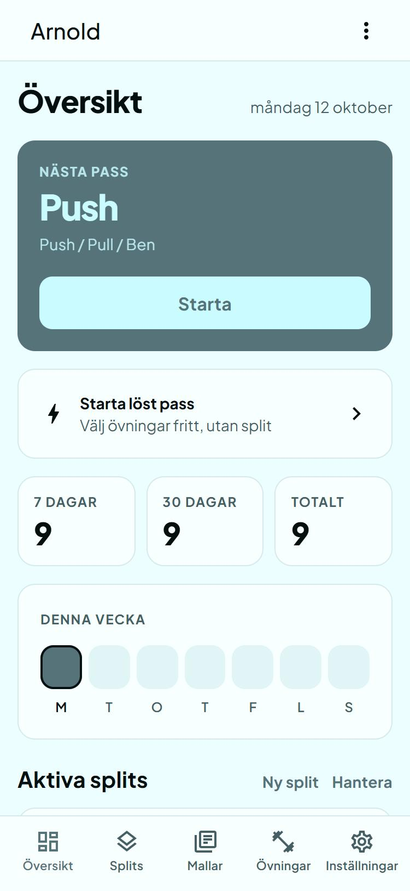
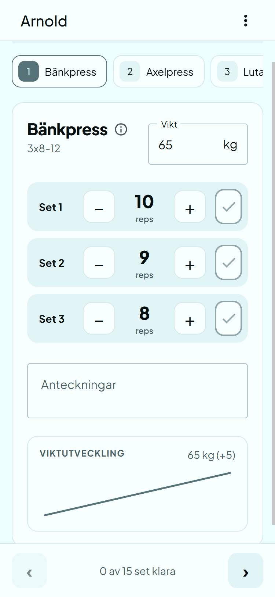
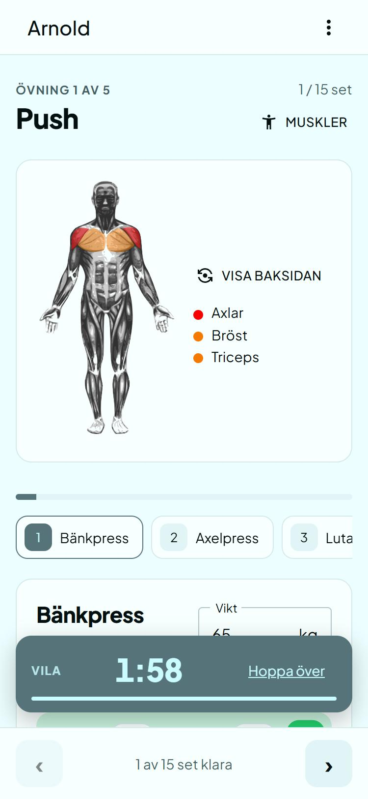
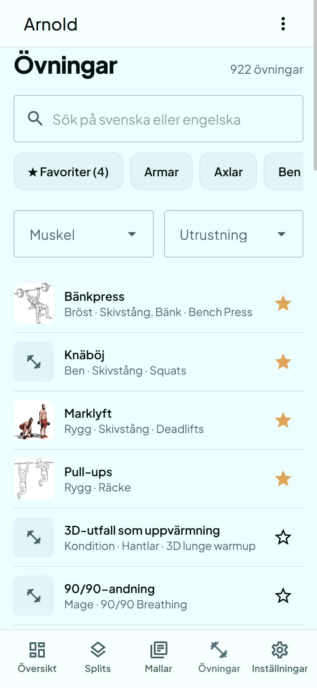
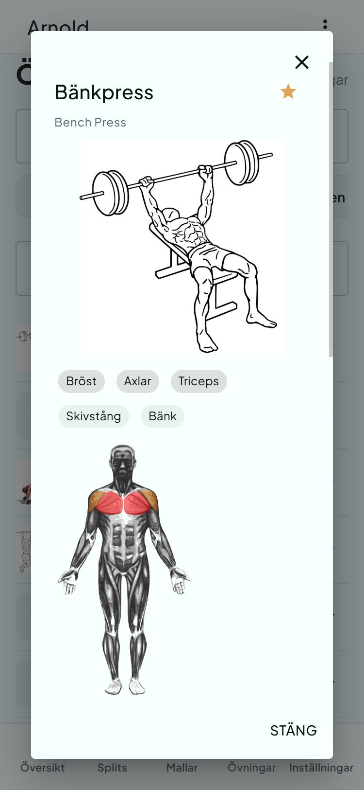

# Tyngd

A mobile-first workout log. Plan your training in splits and passes, log sets, reps and weight while you train,
and see how each exercise develops over time. Installable as a PWA, with the user interface in Swedish.

Built as a full-stack .NET 10 project: Blazor WebAssembly client, ASP.NET Core API, SQL Server.

<table>
  <tr>
    <td></td>
    <td></td>
    <td></td>
    <td></td>
    <td></td>
  </tr>
  <tr>
    <td align="center">Dashboard</td>
    <td align="center">Logging a pass</td>
    <td align="center">Muscle map, rest timer</td>
    <td align="center">Exercise library</td>
    <td align="center">Exercise details</td>
  </tr>
</table>

## Features

- **Splits and passes.** Build your own split, or start from an admin-curated template. Reorder, edit and archive
  without losing history (exercises are archived, never deleted).
- **Pass mode.** Set, reps and weight per exercise, pre-filled from the last time. Progress is stored in the browser
  while you train and synced to the server, so a bad connection in the gym does not lose the session. Saving is
  idempotent per session key.
- **Rest timer.** Counts against the clock, survives reloads and page changes, shows up in the header on other pages
  and notifies you when the rest is over.
- **Free sessions.** Log a pass without a plan: add one exercise at a time, then keep the result as a real pass or
  discard it. The training stays in your history either way.
- **Exercise library.** 900+ exercises with Swedish names and descriptions, searchable in Swedish and English, with
  muscle, equipment and category filters and favorites that float to the top when you build a pass.
- **History per exercise.** Best weight and reps per session, combined across every pass where the exercise appeared.
- **Muscle map.** A body figure per exercise, pass and split showing which muscles are loaded (primary counts 1,
  secondary 0.5).
- **Admin.** User overview, templates, and a catalog tab to sync from wger and review the Swedish translations.

## Tech stack

| Area | Choice |
|---|---|
| Client | Blazor WebAssembly, [MudBlazor](https://mudblazor.com), PWA manifest and service worker |
| API | ASP.NET Core 10 controllers, JWT bearer authentication, built-in rate limiter |
| Data | Entity Framework Core 10, SQL Server; schema in an SSDT project plus numbered SQL migration scripts |
| Tests | xUnit v3 with the EF Core in-memory provider |
| CI | GitHub Actions: build and test |

## Design notes

- **Local exercise catalog instead of live API calls.** Exercises come from [wger](https://wger.de) and are imported
  into an `ExerciseCatalog` table, keyed by wger's uuid. User exercises link to it with an optional foreign key, so
  history survives upstream changes and the app works if wger is down. Free-text exercises still work.
- **Translations that survive re-imports.** Each catalog row stores a hash of the English source text. A sync
  re-translates only rows whose source changed, and never overwrites a reviewed translation: it flags it for review
  instead. The initial Swedish translation is checked in as `Tyngd/Server/Catalog/wger-sv.json`.
- **Free sessions reuse the pass model.** A free session is a pass in a hidden per-user split, so saving, offline sync,
  resume, history and statistics work without a second session model.
- **Migrations as plain SQL.** `Tyngd.Data/Migrations` holds numbered, idempotent scripts.
  `tools/run-migrations.ps1` runs the pending ones and records them with a checksum in `dbo.MigrationHistory`. It only
  accepts allow-listed (local) targets.
- **Authentication.** PBKDF2-HMAC-SHA256 with a per-user salt and an iteration count stored with the hash, so old hashes
  are upgraded on the next login. Login and registration are rate limited per IP. Admin endpoints re-check the role in
  the database on every request, not only in the token.
- **Concurrency.** Writes that can race (creating a session, activating a template, free-session split) rely on unique
  indexes and treat a lost race as success or a retryable conflict.

## Getting started

Prerequisites: the [.NET 10 SDK](https://dotnet.microsoft.com/download), SQL Server (LocalDB is enough) and the
`sqlcmd` command-line tool. The helper scripts are PowerShell and use Windows authentication.

```powershell
# 1. Create a local database (LocalDB, database "Tyngd") from the schema scripts
./tools/create-local-db.ps1

# 2. Set a signing key for the JWTs (any random string of 32+ characters)
dotnet user-secrets set "Jwt:Key" "<random string>" --project Tyngd/Server

# 3. Run
dotnet run --project Tyngd/Server
```

The app is served at the URL printed on startup. The default connection string in `appsettings.json` points at LocalDB,
so a LocalDB setup needs no further configuration.

Machine-specific settings and secrets belong in [user secrets](https://learn.microsoft.com/aspnet/core/security/app-secrets),
which live outside the repository. To use another SQL Server:

```powershell
dotnet user-secrets set "ConnectionStrings:TyngdDb" "Server=localhost;Database=Tyngd;Trusted_Connection=True;TrustServerCertificate=True;" --project Tyngd/Server
$env:TYNGD_SQL_SERVER = "localhost"   # for the scripts in tools/ (optionally TYNGD_SQL_DATABASE too)
```

In deployed environments use environment variables instead (`ConnectionStrings__TyngdDb`, `Jwt__Key`).

### Load the exercise catalog

1. Register a user in the app.
2. Make that user an admin:
   ```sql
   UPDATE UserInfo SET Roles = 'User,Admin' WHERE UserName = '<your user name>';
   ```
3. Log in again, open **Admin → Övningskatalog** and press **Synka från wger**. The sync downloads the catalog from
   wger's public API and applies the checked-in Swedish translations.

### Tests

```powershell
dotnet test Tyngd.Tests
```

The tests use the EF Core in-memory provider, which does not enforce unique indexes. The race handling that depends on
SQL Server error numbers is therefore not covered by unit tests.

### Database migrations

```powershell
./tools/run-migrations.ps1 -Target local -List      # what has run, what is pending
./tools/run-migrations.ps1 -Target local            # run pending scripts
```

### Configuration

| Setting | Purpose |
|---|---|
| `Jwt:Key` | Required. Signing key for tokens (use user secrets locally, an environment variable elsewhere). |
| `Jwt:ExpiryMinutes` | Token lifetime, 480 by default. |
| `ConnectionStrings:TyngdDb` | SQL Server connection string. |
| `ErrorNotifications:*` | Optional email alerts for server and client errors: recipients, SMTP settings, throttle and an hourly cap. |

## Project layout

```
Tyngd/Client        Blazor WebAssembly app (pages, components, services)
Tyngd/Server        ASP.NET Core host: API controllers, wger sync, middleware
Tyngd/Shared        DTOs and models shared by client and server
Tyngd.Data          EF Core entities and DbContext, SQL migration scripts
Tyngd.Database                SSDT database project (schema)
Tyngd.Tests         xUnit tests
tools                   Local database and migration scripts
docs                    Design notes and screenshots
```

## Known limitations

- The JWT is kept in `localStorage` and tokens cannot be revoked before they expire. Admin actions are re-checked in
  the database.
- No email verification or password reset.
- The user interface and the code comments are in Swedish. Identifiers are English except a few legacy database column
  names (`Visability`, `Ordning`).
- The Swedish exercise translations are machine-generated and only partly reviewed.
- The service worker does not cache the app shell, so the app needs a connection to load. Logging a pass that is already
  open keeps working offline.
- The catalog sync lock is per process, which is enough for a single instance.

## License and attribution

The source code is released under the [MIT License](LICENSE).

Exercise text comes from [wger](https://wger.de) under per-exercise Creative Commons licenses (mostly CC BY-SA), and
exercise images are loaded from wger.de with their author and license shown. The muscle illustrations are by Termininja
from Wikimedia Commons (CC BY-SA 3.0). The Swedish translations are adaptations shared under CC BY-SA 4.0.
See [THIRD_PARTY_NOTICES.md](THIRD_PARTY_NOTICES.md) for details.
